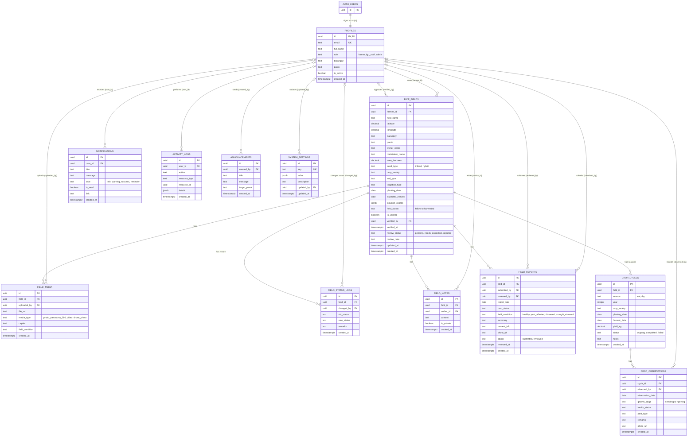

# AgriVista database: entity-relationship diagram

Generated from the Supabase migrations in `supabase/migrations/` (0001 to 0025). PK = primary key, FK = foreign key, UK = unique.

## Reading the diagram

- **PROFILES** is the hub. Every person (farmer, LGU staff, admin) has one profile, created automatically when they sign up through Supabase Auth (`AUTH_USERS`).
- **RICE_FIELDS** is the main record. A farmer owns many fields, and an LGU staff member can approve a field (`verified_by`).
- A field has many media files, status changes, notes, monitoring reports and crop cycles. A crop cycle has many observations.
- **Deleting a user:** a farmer's fields, notifications and profile are deleted with the account (`on delete cascade`). Records that only mention who did something (logs, notes, reports, approvals, uploads) are kept and the reference is cleared (`on delete set null`, migration 0023).
- Lines marked with a circle (`|o`) are optional links. A circle on the "many" side (`o{`) means zero or more.
